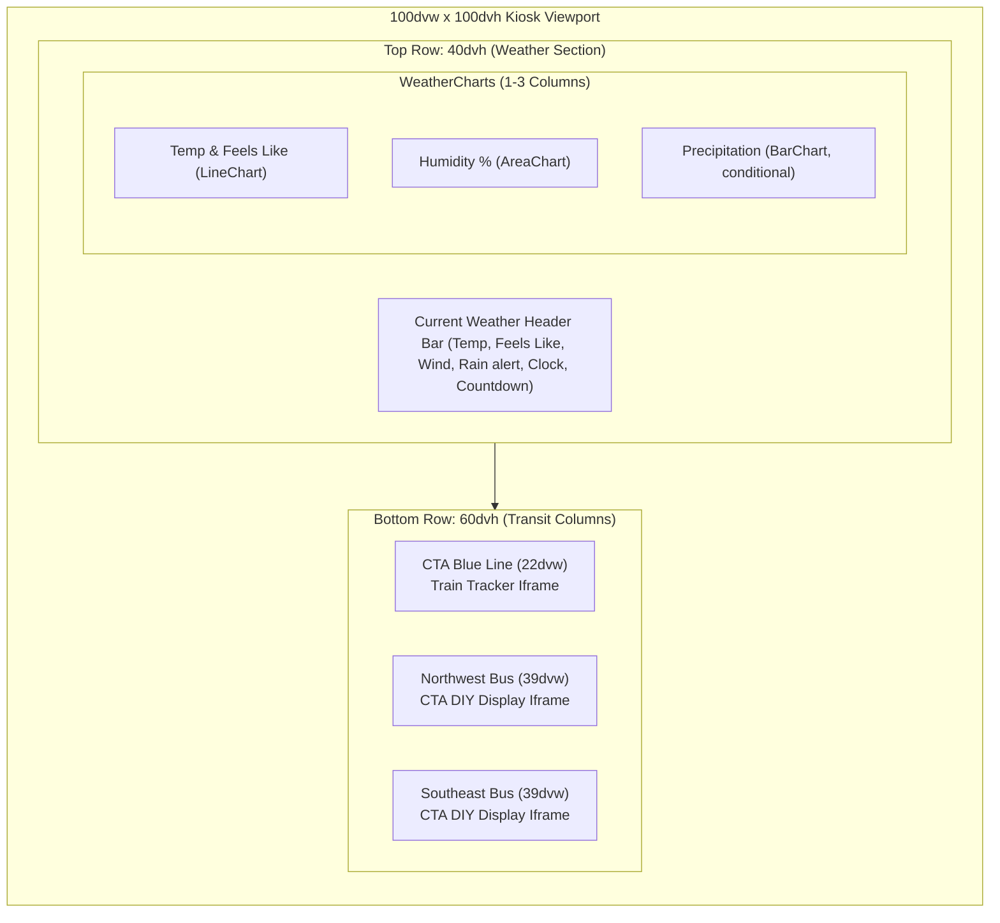

# InfoBoard — Agent Reference Manual (GEMINI.md)

Welcome to **InfoBoard**. This document provides an exhaustive, agent-optimized architectural and operational reference for coding assistants. Its goal is to minimize discovery time, prevent redundant file searches, and avoid token-expensive mistakes.

---

## 1. System Overview & Kiosk Context

InfoBoard is a **passive, non-interactive full-screen information kiosk** designed to run 24/7 on a local wall/desk-mounted 22" 1080p display (1920×1080).

### Key Architectural Constraints
- **Zero Interactivity**: No mouse, keyboard, or touchscreen input. Do **not** add hover tooltips (`<Tooltip />`), clickable buttons, or modals.
- **Viewing Distance**: Readable from 4–6 feet away. All data labels, axes, and text use bold weights, high-contrast colors, and stroke outlines (`paintOrder="stroke fill"`).
- **Fixed Layout**: Locked to `100dvw × 100dvh` with `overflow: hidden`. Never allow vertical or horizontal page scrollbars.
- **Two-Row Responsive Grid**:
  - **Top Row (40dvh)**: Weather header bar + 2 or 3 Recharts time-series graphs.
  - **Bottom Row (60dvh)**: 3 transit columns (CTA Blue Line train tracker + 2 CTA bus arrival iframes).



---

## 2. Agent Execution & Shell Environment Rules

> [!IMPORTANT]
> **Always run shell commands with `BypassSandbox: true`**
> Antigravity standard sandbox mode encounters `fork/exec /home/osama/.gemini/bin/agy: operation not permitted` on this machine. All `run_command` calls must include `BypassSandbox: true`.

> [!IMPORTANT]
> **Prepend Node 22 to `PATH`**
> The system default shell may not have Node in the standard path. Always prepend:
> `PATH="/home/osama/.nvm/versions/node/v22.17.1/bin:$PATH"`

> [!CAUTION]
> **Git Workflow & Commits**
> Never run `git commit` or `git push` without explicit instruction from the user. Verify all code changes with `npm run build` or targeted checks, report results, and await user confirmation.

---

## 3. Directory & File Structure

```
InfoBoard/
├── GEMINI.md               # This agent instruction manual
├── README.md               # User-facing setup & run guide
├── Dockerfile.gui          # Container definition for Next.js GUI & API
├── .dockerignore
├── .env                    # Shared root fallback environment variables (LATITUDE, LONGITUDE)
├── .eslintrc.json
├── .gitignore
├── tsconfig.json           # Root TypeScript configuration
│
└── gui/                    # Next.js 16 application (GUI & API Route Handlers)
    ├── .env.local          # GUI env: NEXT_PUBLIC_LATITUDE, NEXT_PUBLIC_LONGITUDE
    ├── next.config.js      # Next.js config (reactStrictMode: false)
    ├── package.json        # Dependencies: next 16, react 19, recharts 2
    ├── tsconfig.json       # GUI TypeScript config
    └── app/
        ├── layout.tsx      # Root HTML layout (bare body wrapper; metadata only)
        ├── globals.css     # Minimal CSS: body { background #373435; color #fff; margin 0 }
        ├── page.tsx        # Main dashboard: grid layout, weather fetch loop, buildTimeline()
        ├── WeatherCharts.tsx # Weather UI: header bar, Recharts charts, React.memo(ChartGrid)
        └── api/            # Consolidated Next.js Route Handlers
            ├── health/route.ts            # GET /api/health
            └── weather/forecast/route.ts  # GET /api/weather/forecast (Open-Meteo proxy)
```

---

## 4. Operational Commands

All commands must be run with `BypassSandbox: true` and the Node PATH prefix.

### Next.js GUI & Route Handlers (`gui/`)
```bash
# Install dependencies
PATH="/home/osama/.nvm/versions/node/v22.17.1/bin:$PATH" npm --prefix gui install

# Development server (Turbopack, http://localhost:3000)
PATH="/home/osama/.nvm/versions/node/v22.17.1/bin:$PATH" npm --prefix gui run dev

# Production build — ALWAYS run after any code change to verify TypeScript & JSX
PATH="/home/osama/.nvm/versions/node/v22.17.1/bin:$PATH" npm --prefix gui run build

# Start production server
PATH="/home/osama/.nvm/versions/node/v22.17.1/bin:$PATH" npm --prefix gui start

# Lint
PATH="/home/osama/.nvm/versions/node/v22.17.1/bin:$PATH" npm --prefix gui run lint

# Spot-check health and forecast API routes
curl -s http://localhost:3000/api/health
curl -s "http://localhost:3000/api/weather/forecast" | head -c 200
```

> [!TIP]
> `npm run build` is the fastest correctness check after edits — it catches TypeScript errors and JSX parse failures without needing a running browser.

---

## 5. End-to-End Data Flow

```mermaid
sequenceDiagram
    autonumber
    participant OM as Open-Meteo API
    participant Route as Next.js Route Handler (/api/weather/forecast)
    participant Page as GUI page.tsx (:3000)
    participant WC as WeatherCharts.tsx
    participant CG as React.memo(ChartGrid)

    Note over Page: Every 60 seconds (refreshInterval = 60 * 1000)
    Page->>Route: GET /api/weather/forecast?latitude=...&longitude=...
    Route->>OM: GET https://api.open-meteo.com/v1/forecast?...
    OM-->>Route: minutely_15 + hourly + current JSON
    Route-->>Page: Weather payload
    Page->>Page: buildTimeline(current, data, now)
    Page->>WC: Pass timeline + current object
    WC->>CG: Pass timeline + currentPrecip
    Note over CG: Calculates domains/renderers & re-renders SVGs ONLY when weather data changes

    Note over Page: Every 1 second
    Page->>Page: setCurrTime(Date.now())
    Page->>WC: Update currTime + countdown props
    Note over WC: Header re-renders; ChartGrid SVGs skipped (React.memo)
```

---

## 6. Component Architecture (WeatherCharts.tsx)

`WeatherCharts.tsx` is the heaviest file (~627 lines). Its internal component hierarchy:

```
WeatherCharts (default export)
│
│  Owns: weather fetch props + currTime + countdown
│  Renders: current-conditions header bar (clock ticks every 1s here)
│  Memoizes: allTicks, tickMap, domainMax, tempDomain, humDomain, label renderers
│
└── ChartGrid (React.memo)
       │
       │  Owns: stable chart data props only — no clock/countdown
       │  Purpose: decouples SVG redraws from the 1-second clock tick
       │  Renders: 2 charts normally, 3 when rain is expected
       │
       ├── ChartCard (layout wrapper, renders title badge + ResponsiveContainer)
       │     └── LineChart — Temp (°F, orange) + Real Feel (°F, blue dashed)
       │
       ├── ChartCard
       │     └── AreaChart — Humidity (%, cyan area fill)
       │
       └── ChartCard (only when hasRainExpected = totalPrecip > 0.005)
             └── BarChart — Precipitation (inches)
```

### Key helpers inside `WeatherCharts.tsx`

| Function / Hook | Purpose |
|---|---|
| `getWeatherInfo(code, isDay)` | Maps Open-Meteo weather code → `{ desc, icon }` |
| `getWindCompass(deg)` | Converts wind bearing degrees → compass string (N, NE, …) |
| `getDomain(values, padLo, padHi, floor?, cap?)` | Computes a padded Y-axis `[min, max]` domain |
| `ChartCard` | Wrapper component: positions a title badge overlay + `ResponsiveContainer` |
| `buildLabelPositions(points, isBelow)` | Collision resolver: given a sorted list of `{x, y, value}` points, shifts overlapping labels up/down by 14px |
| `makeCollisionAwareLabelList(fill, suffix, isBelow)` | Factory returning a Recharts `content` renderer that accumulates all label positions in one pass (index 0→N) and resolves collisions before painting |
| `renderCustomTick` (`useCallback`) | SVG tick renderer for X-axis: looks up label from `tickMap`, renders "Now" / hour labels in white, sub-hour labels in sky-blue |
| `renderPrecipLabel` (`useMemo`) | Simple bar-top label renderer (no collision logic needed for bars) |

---

## 7. Weather Subsystem Deep Dive

### Open-Meteo API Integration (`api/server.js`)
- **Endpoints served**: `GET /health`, `GET /weather/forecast`
- **Open-Meteo query parameters**:
  - `current`: `temperature_2m,relative_humidity_2m,apparent_temperature,precipitation,weather_code,wind_speed_10m,wind_direction_10m,is_day`
  - `hourly`: `temperature_2m,relative_humidity_2m,apparent_temperature,precipitation,precipitation_probability,weather_code,wind_speed_10m,wind_direction_10m`
  - `minutely_15`: `precipitation,temperature_2m,apparent_temperature,relative_humidity_2m,weather_code`
  - Units: `fahrenheit`, `mph`, `inch`. Timezone: `auto`. Forecast days: `3`.
- **API Model Characteristic**: Weather models output on fixed clock boundaries — `:00, :15, :30, :45` for `minutely_15`; `:00` for `hourly`. There is **no native 1-minute forecast**.

### Timeline Generation (`gui/app/page.tsx → buildTimeline`)
The timeline is an array of `WeatherPoint[]` with continuous minute offsets from `now`:

1. **Point 0 — "Now"**: Uses `current.*` values directly. `timeOffset = 0`, `timeLabel = 'Now'`.

2. **Granular 15-minute block** (first ~75 minutes):
   - `first15 = Math.ceil(nowMs / 900000) * 900000` — snaps to the next `:00/:15/:30/:45` boundary.
   - If `first15 - nowMs < 3 * 60000` (less than 3 min away), advance by one interval to avoid a near-duplicate point right next to "Now".
   - Loops in 15-minute steps while `curr - nowMs <= 75 * 60000`.
   - Data sourced from `minutely_15` arrays via `findClosestIndex`.
   - Labels: on-the-hour → `"8 PM"` format; sub-hour → `"8:15"`, `"8:30"`, `"8:45"` (AM/PM stripped).

3. **Clock-hour block** (beyond the granular window, out to ~6.5 hours):
   - Iterates `h = 1..8` clock hours ahead of the floor of `now`.
   - Only adds a point if `offset >= lastGranularOffset + 10` (prevents overlap) **and** `offset <= 390`.
   - Data sourced from `hourly` arrays via `findClosestIndex`.
   - Labels: `"9 PM"`, `"10 PM"`, etc.

### Recharts Continuous Numeric X-Axis
Unlike categorical charts, InfoBoard uses `type="number"` / `dataKey="timeOffset"` so points are proportionally spaced in real time:
- **Domain**: `[-10, domainMax]` where `domainMax = max(allTicks) + 12`.
- **`tickMap`**: a `Record<number, string>` mapping each `timeOffset` → display label.
- **"Now" suppression**: if the first non-zero tick is `< 10` minutes from Now (`firstNonZero < 10`), `delete tMap[0]` hides the "Now" label to prevent collision. The data point still exists; only the tick label is suppressed.
- **Tick styling**: "Now" and hour labels render in `#f4f4f5` (white); sub-hour marks render in `#38bdf8` (sky blue).

### Performance & Decoupled Rendering
- `refreshInterval = 60 * 1000` ms (1 minute). `currTime` ticks every **1,000 ms**.
- `React.memo(ChartGrid)` receives only stable memoized props — it skips re-render on every clock tick, eliminating ~59 out of 60 SVG redraws per minute.
- All `makeCollisionAwareLabelList` renderers are recreated via `useMemo([timeline])` — they only change when new weather data arrives, not on clock ticks.
- All Recharts series use `isAnimationActive={false}` to prevent jarring transitions during refreshes.

---

## 8. Transit Subsystem

Located in the bottom row (60dvh) of `gui/app/page.tsx`. All transit UI is iframe-based — no custom JS needed.

| Column | Width | Content | Key Params |
|---|---|---|---|
| 1 | 22dvw | CTA Blue Line Train Tracker | `sid=40590`, `results=6`, `sort=time` |
| 2 | 39dvw | CTA Bus DIY Display (Northwest) | `stopid=8929,945,15847`, `bgcolor=335f4c` |
| 3 | 39dvw | CTA Bus DIY Display (Southeast) | `stopid=8849,898,5481`, `bgcolor=5f333b` |

**Cache Busting**: Bus iframes append `&date=${nextRefresh}` (`nextRefresh = lastWeatherUpdate + refreshInterval`), forcing a reload whenever the weather data refreshes — without any visible iframe flicker.

---

## 9. Critical Gotchas & Antipatterns

| Antipattern | Why it fails | Correct Pattern |
|---|---|---|
| Adding `<Tooltip />` to Recharts | Passive kiosk has no cursor/touch events; creates unused DOM nodes and layout artifacts. | Render values directly with `<LabelList content={...} />` and collision-aware renderers. |
| Using string/categorical X-axis | 15-min and 60-min steps would render equidistant, misrepresenting forecast timing. | Use `type="number"`, `dataKey="timeOffset"`, `ticks={allTicks}` with numeric minute offsets. |
| Removing `React.memo` from `ChartGrid` | 1-second clock causes the entire SVG tree to reconstruct 60×/min, spiking CPU. | Keep `ChartGrid` memoized; pass `currTime`/`countdown` only to the header above it. |
| Passing `currTime` or `countdown` into `ChartGrid` props | Defeats memoization — `ChartGrid` will re-render every second. | Only the outer `WeatherCharts` component should consume `currTime`/`countdown`. |
| Running commands without `BypassSandbox: true` | Standard sandbox hits `operation not permitted` on the `agy` executable. | Always set `BypassSandbox: true` in `run_command`. |
| Invoking `git commit` or `git push` | User explicitly prefers verifying fixes in-situ before committing. | Run `npm run build`, report results, and await explicit user approval. |
| Forcing fixed pixel heights (`px`) on outer containers | Breaks the fixed 1080p kiosk layout on zoom or screen size changes. | Use `dvh`/`dvw` for the grid; use `flex: 1` + `minHeight: 0` for inner flex children. |
| Relying on external Express server | Express API was consolidated into Next.js Route Handlers (`/api/weather/forecast`). | Use internal route handlers directly at `/api/weather/forecast`. |
